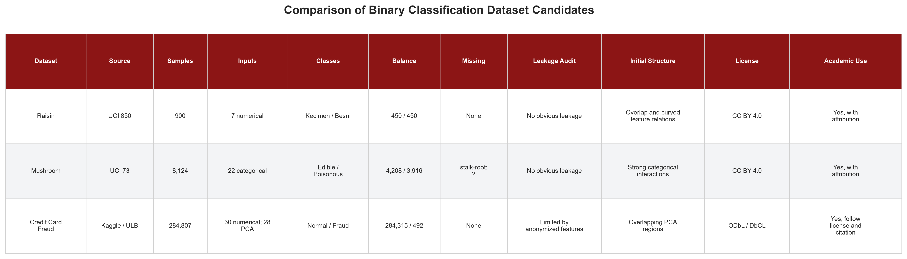
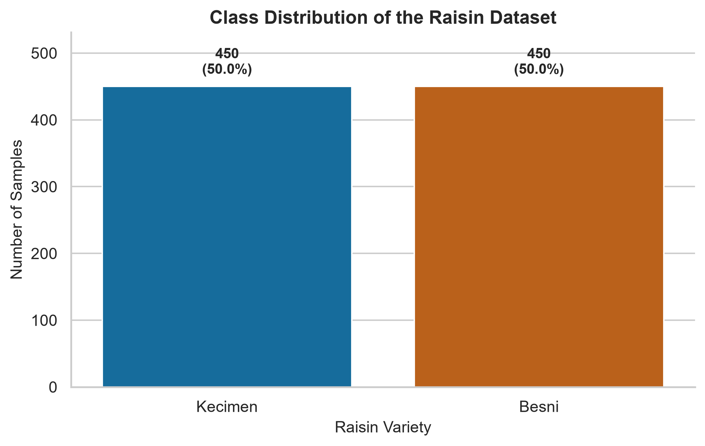
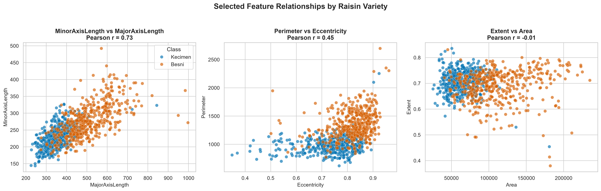
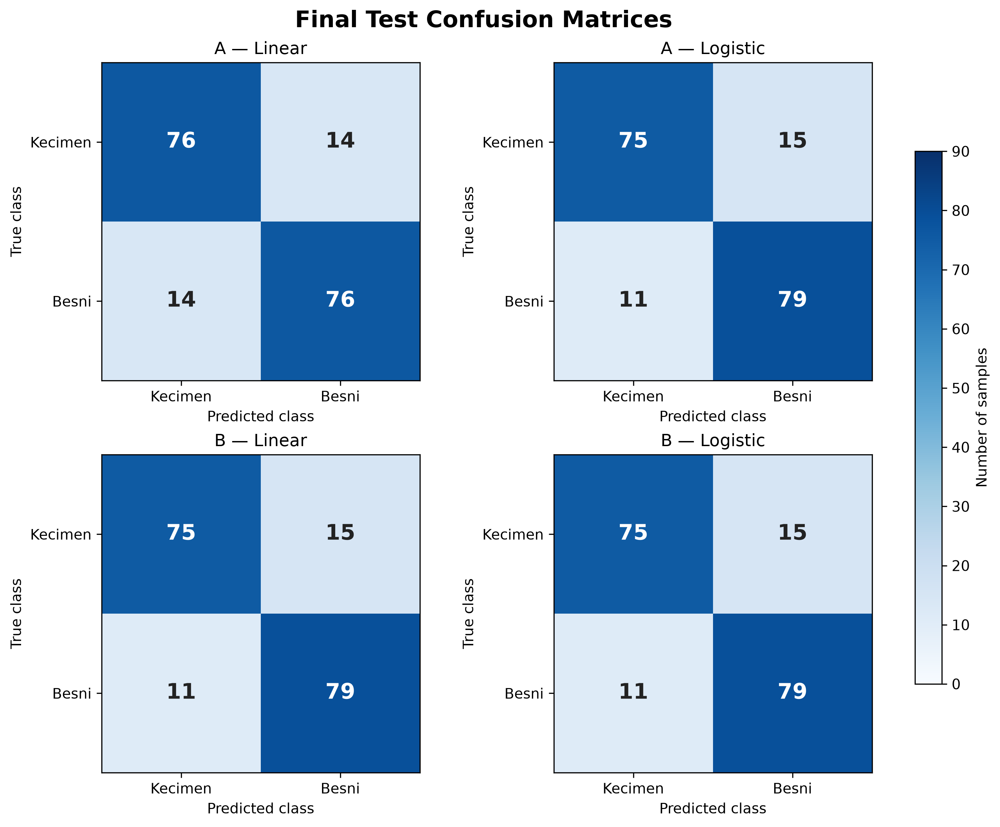
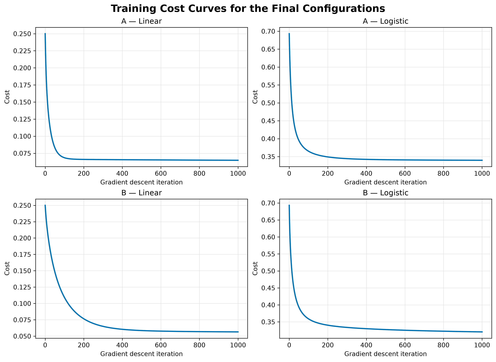

# Linear and Logistic Regression for Binary Classification


## Purpose

This is a learning project. Its purpose is to show that the main ideas from
the first three weeks of *Supervised Machine Learning: Regression and
Classification* can be applied correctly:

- linear and logistic model functions;
- cost functions;
- batch gradient descent;
- feature scaling and polynomial features;
- L2 regularization;
- binary predictions and basic evaluation metrics.

The goal is not to build a complex machine-learning framework. Both models
are implemented directly with NumPy and compared on the same data.

## Dataset

The project classifies two raisin varieties using seven image-derived physical
measurements.

| Item | Value |
|---|---|
| Dataset | Raisin Dataset |
| Source | [UCI Machine Learning Repository](https://archive.ics.uci.edu/dataset/850/raisin) |
| License | CC BY 4.0 |
| Shape | 900 rows x 8 columns |
| Target | `Class` |
| Negative class | `Kecimen` (`0`) |
| Positive class | `Besni` (`1`) |
| Class counts | 450 / 450 |
| Missing values | 0 |
| Duplicate rows | 0 |

See [the dataset note](docs/final_dataset_selection.md) for the source, data
dictionary, license, and selection decision.

<details>
  <summary><strong>Open the three-candidate dataset comparison</strong></summary>
  <br>
  
</details>

## Visual overview

<table>
  <tr>
    <td align="center"><strong>Balanced target classes</strong></td>
    <td align="center"><strong>Selected feature relationships</strong></td>
  </tr>
  <tr>
    <td></td>
    <td></td>
  </tr>
</table>

The selected scatter plots show substantial class overlap and relationships
that are not perfectly represented by one straight boundary. This motivates
the shared degree-two feature experiment without claiming that every relation
in the dataset is nonlinear.

## Experiments

Both models use the same 60/20/20 stratified split.

- Experiment A: seven scaled original features.
- Experiment B: the same features plus degree-two square and interaction terms.

Scaling values are learned from the training set and reused for validation and
test data. The validation set is used for model choices. The test set is kept
for one final evaluation.

A small, explicit candidate list is evaluated with validation accuracy as the
primary selection metric and validation F1-score as the tie-breaker. The
complete selection table is saved to
[`validation_model_selection.csv`](reports/results/validation_model_selection.csv).

## Evaluation artifacts

<table>
  <tr>
    <td align="center"><strong>Test confusion matrices</strong></td>
    <td align="center"><strong>Training cost curves</strong></td>
  </tr>
  <tr>
    <td></td>
    <td></td>
  </tr>
</table>

The numerical results are available in
[`final_model_comparison.csv`](reports/results/final_model_comparison.csv).

## Current status

- [x] Select and document the dataset
- [x] Complete data inspection and visual EDA
- [x] Prepare stratified data splits
- [x] Scale features without data leakage
- [x] Create degree-two polynomial features
- [x] Implement the linear regression classifier
- [x] Implement the logistic regression classifier
- [x] Implement confusion-matrix metrics
- [x] Add unit tests
- [x] Select a small set of hyperparameters using validation data
- [x] Run Experiments A and B
- [x] Evaluate the selected configurations on the held-out test set
- [ ] Write the final comparison

## Repository structure

```text
data/raw/raisin/                     Unchanged source dataset
docs/final_dataset_selection.md      Dataset note and data dictionary
experiments/01_dataset_candidate_analysis/
                                     Initial candidate comparison
experiments/05_final_model_comparison/
                                     Validation selection and final evaluation
notebooks/basic_data_inspection.ipynb
                                     Basic checks
notebooks/exploratory_data_analysis.ipynb
                                     EDA figures and data split
notebooks/data_preprocessing.ipynb   Encoding, scaling, and features
src/linear_regression_classifier.py Linear model
src/logistic_regression_classifier.py
                                     Logistic model
src/metrics.py                       Evaluation metrics
tests/                               Unit tests
reports/results/                     Reproducible CSV result tables
reports/figures/                     Report-ready PNG and PDF figures
```

## Setup

```powershell
python -m venv .venv
.\.venv\Scripts\Activate.ps1
python -m pip install -r requirements.txt
```

Run tests from the repository root:

```powershell
python -m pytest -q
```

Regenerate validation selection and final evaluation artifacts:

```powershell
python experiments/05_final_model_comparison/final_model_comparison.py
```

## Project rules

- Do not use ready-made linear or logistic regression model classes.
- Do not modify files under `data/raw/`.
- Use the same data and features for both models.
- Learn preprocessing values from training data only.
- Do not use test results to choose model settings.
